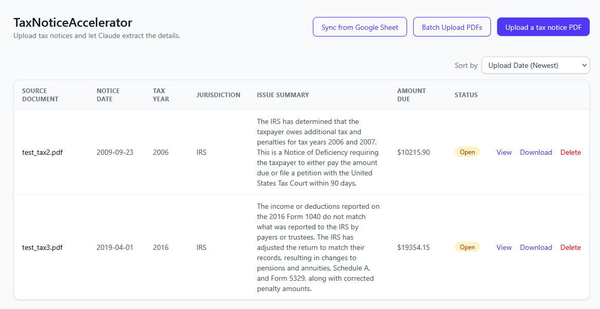
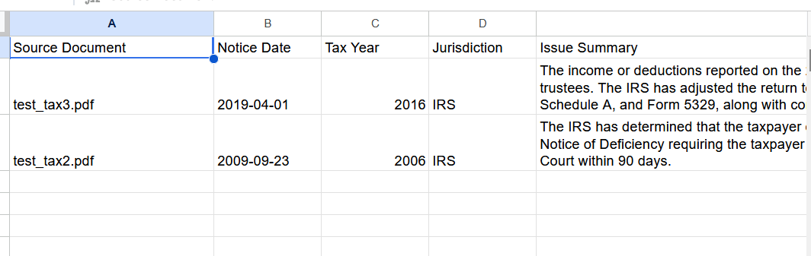

# Tax Notice Accelerator

Corporate tax teams need to contend with a never-ending stream of tax notices being mailed to their doorstep. Turn that pile of tax notice PDFs into a searchable table of what's owed, to whom, and why.

Upload IRS or state tax notices and TaxReader uses Claude to pull out the key details: tax year, notice type, amount due, issuing agency, and a plain-English summary. Everything is shown in a local dashboard and can be exported to Google Sheets.





## Requirements

- [uv](https://docs.astral.sh/uv/) (Python package/env manager)
- Node.js (for the frontend)
- An Anthropic API key

## Notes

- **PDF contents are sent to Anthropic's API** for extraction. See [Anthropic's privacy policy](https://www.anthropic.com/legal/privacy) for how API data is handled.


## Setup

```
cp .env.example .env
```

**To export to Google Sheets, the destination sheet must be shared with a [Service Account](https://docs.cloud.google.com/iam/docs/service-accounts-create#creating)**

Edit `.env` and set:

| Variable            | Required | Description                                             |
| ------------------- | -------- | ------------------------------------------------------- |
| `ANTHROPIC_API_KEY` | Yes      | Used to extract fields from uploaded PDFs               |
| `DB_PATH`           | No       | SQLite database location (default: `taxreader.db`)     |
| `GOOGLE_SHEET_ID`           | No       | ID of the target Google Sheet (the long id in its URL) that the dashboard syncs to     |
| `GOOGLE_SERVICE_ACCOUNT_FILE`           | No       | [Google service-account](https://docs.cloud.google.com/iam/docs/keys-create-delete#creating) JSON key path, used to sync the dashboard to a Google Sheet (default: `service-account.json`     |

## Running

Backend (from the repo root):

```
uv run app.py
```

Serves the API on `http://localhost:5000`.

Frontend:

```
cd frontend
npm install
npm run dev
```

Serves the dashboard on `http://localhost:5173`, proxying `/api` requests
to the Flask backend.

## Testing

```
uv run pytest
```

Unit tests for `app.py` live in `tests/`. They mock every call into
`extract.py` and `sheets.py`, so the suite never makes real Anthropic/Google
API calls or touches the real `taxreader.db`/`taxdocs/`.


## Project layout

- `app.py` — Flask app: upload, list, and file-download routes
- `extract.py` — sends uploaded PDFs to Claude and returns extracted fields
- `db.py` — SQLite storage (`taxreader.db`, path configurable via `DB_PATH`)
- `frontend/` — React + TypeScript dashboard
- `taxdocs/` — uploaded PDFs are stored here (not committed)
- `tests/` — unit tests for `app.py` (`uv run pytest`)
